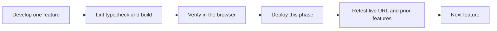
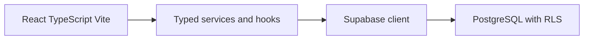

# BrightPath CRM feature-by-feature build

Working context for this project. Implementation of product code starts only when a phase is explicitly approved. After a phase is approved, work stops at the end of that phase until the next phase is approved.

Source: [BrightPath_CRM_Full_Master_Build_Prompt.docx](BrightPath_CRM_Full_Master_Build_Prompt.docx). The filename `BrightPath_CRM_Antigravity_Full_Build_Prompt.docx` is not in this workspace. This plan follows the master brief that is present.

## Current project

[package.json](package.json) is a Vite + React 19 app (`dev`, `build`, `lint`, `preview`). [src/App.jsx](src/App.jsx) is the default counter starter. There is no TypeScript, router, Supabase client, tests, or Git repository.

The brief requires React + TypeScript + Vite, Supabase Auth/PostgreSQL with row-level security, GitHub, and a Vercel frontend. Styling stays one system: the existing plain CSS, restyled as a navy/blue SaaS dashboard. New runtime dependencies are limited to React Router and `@supabase/supabase-js`, plus TypeScript tooling.

## How every phase is closed

Each phase uses the same gate. The next phase does not start until the current gate is recorded.



1. State the phase goal and the files expected to change.
2. Implement only that feature. Database calls stay in typed services/hooks, not inside large page components.
3. Run `npm run lint`, a TypeScript check, and `npm run build`. Record PASS, FAIL, or NOT RUN.
4. Exercise the feature in the browser the way a user would: click, type, submit, refresh, and check empty, error, and loading states.
5. Commit and push only after that phase is approved. `.env`, service-role keys, and real personal data stay out of Git.
6. Deploy the frontend to Vercel, or apply SQL to Supabase when the phase is a database change. Account setup that only the project owner can do is a blocker, not a claimed success.
7. Open the live URL and retest this feature plus every feature already shipped. Fix P0 failures before the next phase.
8. Update a testing checklist with the command or manual step and the observed result.

Demo data is fictional and labeled as demo data. Missing Supabase config shows a configuration error. It does not fall back to fake analytics.

## Architecture



Roles are `admin`, `manager`, and `counsellor`. New profiles default to counsellor. Users cannot change their own role in the UI or through a client update. Route guards are UX only. Access is enforced by RLS.

Lead statuses: New, Contacted, Qualified, Converted, Lost. Marking Lost requires a reason. Follow-up statuses: pending, completed, cancelled. An item is overdue only when it is pending and `due_at` is before now.

KPI definitions, used by both dashboard and reports:

- Total leads: working leads the signed-in user can read (`archived_at` is null)
- New leads: those working leads with status New
- Converted leads: those working leads with status Converted
- Conversion rate: converted / total × 100, nearest whole percent, labeled as such, zero when total is 0
- Overdue follow-ups: pending follow-ups with `due_at` before now, including rows on archived leads

Counsellor metrics match the rows that user can access. Manager and admin metrics are team-wide.

## Phase checklist

- [ ] Phase 0: Inspect starter, record baseline, initialize Git only when the first commit is approved
- [x] Phase 1: TypeScript app shell, navigation, theme, and route shells. Local checks passed. Vercel deploy and live retest are NOT RUN until GitHub and Vercel exist.
- [x] Phase 2: Shell refined and Supabase client connected. Local checks passed. A real project opens the desk. Vercel deploy is NOT RUN.
- [x] Phase 3: Migration and fictional seed are in the repo. Owner confirmed the SQL Editor run. The API sees all four tables and rejects anonymous access. Two-user policy test remains NOT RUN.
- [x] Phase 4: Sign-in, sign-out control, session restore, and a read-only profile are in the app. Signed-out gate and rejected password passed locally. A later signed-in session opened the desk and survived refresh. A sign-out click, missing profile, and the live URL remain NOT RUN.
- [x] Phase 5: Lead list, create, edit, search, filter, archive, and restore passed locally for the signed-in counsellor. The select policy was updated in the SQL Editor. Two-user comparison and Vercel stay NOT RUN.
- [x] Phase 6: Follow-up create, upcoming, overdue, complete, and cancel passed locally for the signed-in counsellor on Meera Kapoor. A second account, the dashboard count, activity rows, and Vercel stay NOT RUN.
- [x] Phase 7: Activity history for create, status, notes, and follow-up completion passed locally for the signed-in counsellor on a new fictional lead. Meera Kapoor was not backfilled. A second account and Vercel stay NOT RUN.
- [x] Phase 8: Dashboard KPIs from permitted data, reconciled with the signed-in counsellor's lists. A second account and Vercel stay NOT RUN.
- [x] Phase 9: Reports using the same metric definitions as the dashboard. A second account and Vercel stay NOT RUN.
- [x] Phase 10: Settings for display name and simple preferences; role read-only. A second account and Vercel stay NOT RUN.
- [x] Phase 11: Accessibility, responsive layout, and truthful error states across shipped screens. Sign-out, a forced expired token, a second account, and Vercel stay NOT RUN.
- [ ] Phase 12: README, security limitations, handover, and final live regression

## Ordered phases

### Phase 0 — Inspect and baseline

Inspection is already done and recorded here. The app is the Vite React starter in JavaScript. [package.json](package.json) has `dev`, `build`, `lint`, and `preview`. [src/App.jsx](src/App.jsx) is the counter template. [index.html](index.html) loads `/src/main.jsx`. [vite.config.js](vite.config.js) is the default React plugin config. [.gitignore](.gitignore) already excludes `node_modules` and `dist`. Git is not initialized. There is no remote.

Phase 0 does not get its own commit. The first Git commit is the verified Phase 1 shell, using the commands in the Phase 1 flow. No product UI and no Vercel deploy belong to Phase 0.

### Phase 1 — App shell

Status: implemented and verified locally. Vercel deploy is NOT RUN.

Local results:

- `npm run typecheck`: PASS
- `npm run lint`: PASS
- `npm run build`: PASS
- Browser: PASS on a 1280px desktop width and a narrow width. Sidebar and mobile nav, all five routes, refresh on `/leads` and `/settings`, unknown path inside the shell, sample status labels, and the loading preview.
- Live URL retest: NOT RUN. No GitHub remote and no Vercel project.

Goal: replace the Vite counter starter with a TypeScript app shell that can be clicked through locally. Pages are shells. They do not read or write data.

#### Strategy

Keep one styling system: plain CSS in [src/index.css](src/index.css), restyled with navy, white, and neutral tokens. Status uses a text label and a color. Add only `typescript` and `react-router-dom` in this phase. Leave `@supabase/supabase-js`, auth, SQL, and live metrics for later phases.

Put a small `index.ts` in each feature folder so Git tracks the layout. Those files export nothing the shell needs yet.

Each route renders inside one shared shell:

- `/` Dashboard
- `/leads` Leads
- `/follow-ups` Follow-ups
- `/reports` Reports
- `/settings` Settings
- any other path: a not-found view inside the same shell

Desktop shows a persistent sidebar. A narrow viewport shows a top bar and a compact nav. Page shells use the shared empty state and say which later phase fills them. The dashboard shows the five lead statuses as sample labels, with the words "Sample labels, not live data". A visible control previews the loading state so that component can be checked without pretending a request ran.

Direct visits and refreshes on `/leads` must work locally. [vercel.json](vercel.json) rewrites all paths to `index.html` so the same routes work after a later Vercel deploy.

#### Files expected to change

Add:

- `tsconfig.json`, `tsconfig.app.json`, `tsconfig.node.json`, `src/vite-env.d.ts`
- `vite.config.ts` and `vercel.json`
- `src/main.tsx`, `src/App.tsx`, `src/router.tsx`
- `src/components/layout/AppShell.tsx`, `Sidebar.tsx`, `MobileNav.tsx`
- `src/components/ui/StatusBadge.tsx`, `EmptyState.tsx`, `LoadingState.tsx`
- `src/pages/DashboardPage.tsx`, `LeadsPage.tsx`, `FollowUpsPage.tsx`, `ReportsPage.tsx`, `SettingsPage.tsx`, `NotFoundPage.tsx`
- `src/types/navigation.ts` for the route list and status labels
- `src/features/dashboard/index.ts`, `src/features/leads/index.ts`, `src/features/followups/index.ts`
- `src/hooks/index.ts`, `src/lib/index.ts`, `src/services/index.ts`, `src/utils/index.ts`

Change:

- [index.html](index.html): title `BrightPath CRM`, script `/src/main.tsx`
- [package.json](package.json): add `typecheck` (`tsc -b --noEmit`) and the two new dependencies
- [src/index.css](src/index.css): replace the Vite purple starter theme with the shell layout and tokens

Remove after the TypeScript entry replaces them:

- `src/App.jsx`, `src/main.jsx`, `src/App.css`, `vite.config.js`
- starter-only image imports that the shell no longer uses

Leave [public/favicon.svg](public/favicon.svg) and [public/icons.svg](public/icons.svg) in place.

#### Implementation order

1. Add TypeScript config and `typecheck`, then rename the Vite config and entry files so `npm run dev` still starts.
2. Add the router and five page shells plus not-found, with no layout yet, and confirm each URL renders.
3. Add the shell, sidebar, and mobile nav, and wrap every route in that layout.
4. Add status badge, empty state, and loading preview, then apply the navy theme.
5. Add `vercel.json` and the feature-folder placeholders.
6. Run local checks and the browser pass below.
7. Run the Git commands only after that pass succeeds.

#### Local checks

Record PASS, FAIL, or NOT RUN:

- `npm run typecheck`
- `npm run lint`
- `npm run build`

Browser pass on desktop and a narrow width:

- Open `/`. The counter starter is gone. The sidebar or mobile nav is visible.
- Open Leads, Follow-ups, Reports, and Settings from the nav. The address bar matches the page.
- Refresh on `/leads` and `/settings`. The same page returns.
- Open an unknown path. The not-found view stays inside the shell.
- Keyboard: tab to each nav link and follow one with Enter. Focus is visible.
- Status samples show the words New, Contacted, Qualified, Converted, and Lost, plus the sample-label notice.
- Trigger the loading preview and confirm it is marked as a preview.
- Empty states name the page and do not show fake counts.

#### Git flow

Run this only after the local checks and browser pass. [.gitignore](.gitignore) already excludes `node_modules` and `dist`. Before `git add`, read `git status` and confirm those folders are untracked-ignored, and that no `.env` file is staged.

```powershell
git init
git add .
git commit -m "first commit"
```

This single commit is the Phase 1 shell, `plan.md`, and the existing starter files that remain. There is no earlier commit of the untouched counter app.

#### Deploy gate

There is no Git remote and no Vercel project. Push and the live retest stay NOT RUN until a GitHub repository and a Vercel project exist. Do not invent a deployment URL. When those accounts are ready, the follow-up is: push `main`, import the repo in Vercel with build `npm run build` and output `dist`, open the live URL, and repeat the browser pass including a refresh on `/leads`.

### Phase 2 — Shell refinement and Supabase client

Status: implemented and verified locally. Vercel deploy is NOT RUN.

Local results:

- `npm run typecheck`: PASS
- `npm run lint`: PASS
- `npm run build`: PASS
- Browser: PASS. Missing settings show the configuration screen and name the variables. An unreachable project shows a connection error and keeps the desk closed. The real project opens the desk, refresh on `/leads` stays on Leads, and route motion stops when reduced motion is requested.
- Live URL retest: NOT RUN. Vercel is not connected.

Goal: make the existing shell look like a working admissions desk, then connect the public Supabase client. Pages stay empty of live records. Auth, SQL, and dashboard numbers stay in later phases.

#### Visual strategy

Stay in one stylesheet, [src/index.css](src/index.css). No component library, no Tailwind, and no animation package.

The current shell uses a filled navy sidebar, blue active pills, cool gray panels, and system UI type. Phase 2 replaces that with a quieter operations layout:

- Paper background `#f4f1ea`, ink text `#1c1915`, and an off-white surface `#fffcf7`.
- Sidebar in ink `#1c2430`. The active item is marked by a 2px brass bar `#8d6a3a`, not a filled blue pill.
- Borders are 1px `#e3dbd0`. Corner radius stays at 2px. No gradients, glass, drop shadows, or emoji.
- Wordmark and page titles use Newsreader. Labels, navigation, and body copy use Public Sans. Both load from one Google Fonts stylesheet in [index.html](index.html) with `font-display: swap`.
- Status remains a word plus a color. Chips become small rectangular labels, still reading New, Contacted, Qualified, Converted, and Lost, under the heading "Sample labels, not live data".

#### Motion

Motion is short and tied to a change on screen. CSS only.

- The main column fades and rises 8px over 180ms when the route changes. The stage element is keyed by the pathname so the animation replays.
- The brass active bar grows from the left over 160ms.
- Panels on a page enter in sequence, 40ms apart, and stop after the first four.
- The loading mark rotates. That is the only looping animation.
- Buttons change color over 150ms. Pressing one moves it 1px down.
- `prefers-reduced-motion: reduce` disables transform, fade, and spin. Content still appears immediately.

#### Supabase strategy

Add `@supabase/supabase-js` only. Create the client in [src/lib/supabaseClient.ts](src/lib/supabaseClient.ts) when both variables exist:

- `VITE_SUPABASE_URL`
- `VITE_SUPABASE_ANON_KEY`

The anon key is public browser config. The service-role key and database password never go in frontend code, `.env.example`, or chat. Add `.env` to [.gitignore](.gitignore). Commit `.env.example` with placeholders only.

A small config reader reports the missing variable names. It never prints the key. If either value is missing, the shell is replaced by a configuration screen that names the missing variables and says the app is not using sample data. If both values are present, the app calls `auth.getSession()` once. Tables do not exist yet, so this phase does not query leads. A rejected session call shows a connection error with the Supabase message and keeps the shell unavailable. A successful call reveals the shell.

You create the Supabase project and put the real values in local `.env`. Those values are not pasted into chat.

#### Files expected to change

Add:

- `.env.example`
- `src/lib/supabaseConfig.ts` and replace the placeholder in `src/lib/supabaseClient.ts`
- `src/components/config/ConfigGate.tsx` and `ConfigScreen.tsx`

Change:

- [index.html](index.html) for the font links
- [src/index.css](src/index.css) for tokens, type, nav indicator, page motion, and reduced motion
- [src/components/layout/AppShell.tsx](src/components/layout/AppShell.tsx) so the page stage remounts on navigation
- [src/App.tsx](src/App.tsx) so `ConfigGate` wraps the router
- [package.json](package.json) for `@supabase/supabase-js`
- [.gitignore](.gitignore) for `.env`

Routes and page copy stay as they are.

#### Implementation order

1. Replace the visual tokens, type, and shell styling. Confirm every current route still renders.
2. Add the route transition, active-bar motion, staggered panels, and the reduced-motion cutoff.
3. Add the Supabase package, config reader, client, and configuration screen.
4. Run `npm run typecheck`, `npm run lint`, and `npm run build`.
5. Run the browser pass below.
6. After that pass, commit this phase. Do not push unless the `pawantiwaridnn-collab` login is the one Git uses.

#### Local checks

Record PASS, FAIL, or NOT RUN:

- `npm run typecheck`
- `npm run lint`
- `npm run build`

Browser pass on desktop and a 390px width:

- With `.env` absent, the configuration screen names the missing variables and the five routes are not shown.
- Restore `.env` with real values. The shell returns, `getSession()` succeeds, and a refresh on `/leads` still shows Leads.
- Move across Dashboard, Leads, Follow-ups, Reports, and Settings. The main column animates once per route, and the brass bar marks the current item.
- Show the loading preview and confirm the mark rotates and the text says it is a preview.
- Emulate reduced motion and confirm the route change does not move or fade.
- Put a bad anon key in `.env`, restart the dev server, and confirm the connection error is visible. Put the real key back afterward.

#### Deploy gate

Vercel is still not connected. The live retest stays NOT RUN. When Vercel exists, set the same two variables there, redeploy, and repeat the missing-config and successful-shell checks on the live URL.

### Phase 3 — Schema, constraints, and RLS

Status: SQL is in the repository and the owner confirmed the SQL Editor run.

Local results:

- Static SQL review: PASS. A counsellor can read a lead only when they created it or are assigned. A signed-in client cannot change `role`. There is no client delete policy.
- `npm run typecheck`: PASS
- `npm run lint`: PASS
- `npm run build`: PASS
- Supabase SQL Editor: PASS, confirmed by the project owner.
- API check without a signed-in user: PASS. `profiles`, `leads`, `follow_ups`, and `activities` are present. Anonymous requests receive permission code 42501, which matches the revoked anonymous grants.
- Two-user policy test: NOT RUN. It waits for Phase 4 accounts.

Goal: put a repeatable schema in the repository. The app does not query these tables yet. Leads, follow-ups, and auth screens stay in later phases.

There is no Supabase project to apply this to yet. This phase writes the SQL and explains how to run it. It does not call the Supabase API, does not put keys in source files, and does not mark the hosted database as updated. That check stays NOT RUN until you create a project, run the SQL yourself, and confirm the result.

#### What you do before the hosted check

1. Create an empty project at https://supabase.com/dashboard. Choose a region close to you.
2. In Project Settings, API, copy the project URL and the anon or publishable key.
3. Put them in local `.env` as `VITE_SUPABASE_URL` and `VITE_SUPABASE_ANON_KEY`. Do not paste the key into chat.
4. Restart the dev server and confirm the admissions desk opens.
5. After the migration file is in the repo, open the Supabase SQL Editor, paste that file, and run it.
6. In Table Editor, confirm `profiles`, `leads`, `follow_ups`, and `activities` exist and Row Level Security is enabled.
7. Reply that the SQL succeeded, or paste the error text with secrets removed.

Until step 7, the hosted verification is NOT RUN.

#### Schema

One migration, `supabase/migrations/20261019140000_init_crm.sql`. UUID primary keys, `timestamptz` timestamps, and `gen_random_uuid()` for new ids.

`profiles`

- `id` references `auth.users(id)` and is removed with that user
- `full_name` text, required
- `role` text, default `counsellor`, limited to `admin`, `manager`, `counsellor`
- `created_at`, `updated_at`

`leads`

- `full_name` and `phone` required after trim
- `email` optional, and when present it must contain one `@` and a dot in the domain
- `course_interest` required
- `source` limited to `website`, `call`, `messaging`, `referral`, `walk-in`
- `status` default `New`, limited to `New`, `Contacted`, `Qualified`, `Converted`, `Lost`
- `lost_reason` required only when status is `Lost`
- `assigned_to` and `created_by` reference `profiles`
- `notes` optional
- `archived_at` optional, so a lead is hidden from daily work without deleting history
- `created_at`, `updated_at`

`follow_ups`

- `lead_id`, `assigned_to`, `due_at`, `note`, `created_by`
- `status` default `pending`, limited to `pending`, `completed`, `cancelled`
- `completed_at` is set only when status is `completed`
- deleting a lead is restricted while follow-ups exist

`activities`

- `lead_id`, `actor_id`, `activity_type`, `description`
- optional `metadata` jsonb
- `created_at`
- deleting a lead is restricted while activities exist
- clients cannot update or delete activity rows

Indexes: lead status, source, assignee, creator, and `created_at`; follow-up lead, assignee, status, and `due_at`; activity lead and `created_at`; profile role.

A `updated_at` trigger covers `profiles` and `leads`. A signup trigger inserts a `profiles` row with role `counsellor` when a new auth user appears. The missing-profile screen in Phase 4 still exists for the moment before that trigger finishes.

#### Access rules

RLS is enabled on all four tables. A `current_role()` helper reads the signed-in profile with a fixed `search_path`. Policies are separate for select, insert, update, and delete.

- A user reads their own profile. Managers and admins read profiles so they can assign work.
- A user updates their own name. A client update cannot change `role`. The SQL editor can, because `auth.uid()` is null there. That is the admin bootstrap: after the owner signs up, one reviewed `update` sets that profile to `admin`. There is no in-app path to become admin.
- A counsellor reads and updates leads they created or are assigned. A manager or admin reads and updates every lead.
- Inserts store `created_by` or `actor_id` as the signed-in user.
- Follow-up and activity access follows access to the parent lead.
- There is no client delete policy. Leads are archived. Follow-ups are cancelled. Activities stay.

#### Seed

`supabase/seed.sql` is optional and separate. It inserts a few fictional people and leads and is safe to run once. The app does not run it on startup. It is not applied during this phase unless you choose to run it after the migration.

#### Files expected to change

Add:

- `supabase/migrations/20261019140000_init_crm.sql`
- `supabase/seed.sql`

The React app, routes, and `.env` stay as they are. No new npm dependency.

#### Flow

1. Write the migration in the order tables, constraints, indexes, helper, RLS, policies, triggers.
2. Write the fictional seed file.
3. Read the SQL for policy gaps: a counsellor must not read another counsellor's lead, and a client must not change `role`.
4. Run `npm run typecheck`, `npm run lint`, and `npm run build`. The app should still open exactly as it does now.
5. Commit the SQL. Do not push.
6. Stop. Hosted verification waits for the project and your SQL Editor result.

#### Checks

- Static SQL review: PASS only after the file is written and read back.
- `npm run typecheck`, `npm run lint`, `npm run build`: run and record the real result.
- Supabase SQL Editor: PASS, confirmed by the project owner. Anonymous API checks see all four tables and are denied access.
- Two-user policy test: NOT RUN. It belongs after Phase 4, when two accounts exist.

### Phase 4 — Authentication and profiles

Status: implemented. Local signed-out gate and rejected password passed on 2026-10-19. Valid sign-in, refresh, and sign-out stay NOT RUN until you use a dashboard user. Missing profile and a forced expired token stay NOT RUN. Vercel stays NOT RUN.

Goal: a signed-out visitor sees only the sign-in page. A signed-in user with a profile sees the admissions desk, their name, and a read-only role. Leads, follow-ups, and name editing stay in later phases.

The route guard is only a screen choice. The database policies from Phase 3 remain the real boundary.

#### What you do before the valid sign-in check

1. In the Supabase dashboard, open Authentication, then Users, then Add user.
2. Use an email and password you control. Turn on auto-confirm so the account can sign in immediately.
3. Do not paste the password into chat. After the screen exists, sign in yourself in the browser at http://127.0.0.1:5173/.
4. The signup trigger should insert a `profiles` row with role `counsellor`. If the desk says the profile is missing, tell me and do not try to set the role from the page.

There is no public sign-up form and no control that can make someone an admin.

#### Screen flow

`ConfigGate` stays first. Missing Supabase settings still replace the whole app.

After the project is reachable:

1. While the session is unknown, show "Checking your session" with the existing loading mark.
2. With no session, show the sign-in page. The desk navigation is not rendered.
3. On submit, disable the button. A wrong email or password stays on the page and says the credentials were not accepted. The Supabase message is not replaced with a success state.
4. With a session, load `profiles` where `id` is `auth.uid()`.
5. If that row is missing, show a missing-profile page and a sign-out action. Do not offer a role picker.
6. If the row exists, show the desk. The sidebar shows the profile name and the role as text. Sign out returns to the sign-in page and clears the session.
7. A refresh with a stored session skips sign-in and opens the desk again.
8. If Supabase reports the session ended, return to sign-in with "Your session ended. Sign in again."

Settings keeps the Phase 10 empty state for preferences and adds a read-only identity block: name and role as text, not inputs.

The sign-in page uses the same paper card, Newsreader title, and brass kicker as the configuration screen. The button keeps the existing 150ms color change and 1px press. No new animation library. Reduced motion still disables movement.

#### Files expected to change

Add:

- `src/types/profile.ts`
- `src/services/profileService.ts` with one function that reads the signed-in profile
- `src/features/auth/AuthProvider.tsx`
- `src/pages/SignInPage.tsx`
- `src/pages/MissingProfilePage.tsx`

Change:

- [src/App.tsx](src/App.tsx) so the auth provider sits inside `ConfigGate` and around the router
- [src/router.tsx](src/router.tsx) so the desk routes render only for a signed-in profile
- [src/components/layout/AppShell.tsx](src/components/layout/AppShell.tsx) and [Sidebar.tsx](src/components/layout/Sidebar.tsx) for the name, role text, and sign-out button
- [src/pages/SettingsPage.tsx](src/pages/SettingsPage.tsx) for the read-only identity block
- [src/index.css](src/index.css) for the sign-in fields, using the existing tokens

No new npm dependency. The Supabase client already exists.

#### Flow

1. Add the profile type and the single-row profile read.
2. Add the session listener and the three states: checking, signed out, missing profile, ready.
3. Build the sign-in page and wire invalid credentials, saving, and sign-out.
4. Show name and read-only role in the sidebar and on Settings.
5. Run `npm run typecheck`, `npm run lint`, and `npm run build`.
6. In the browser, confirm a signed-out visit shows only sign-in, a bad password stays on that page, and the role is text rather than a field.
7. You complete the valid sign-in, refresh, and sign-out in the browser. Those three stay NOT RUN until you do them.
8. Commit this phase. Do not push. The Vercel retest stays NOT RUN.

#### Checks

- `npm run typecheck`, `npm run lint`, `npm run build`: PASS
- Signed-out gate and rejected password: PASS. `/leads` shows Sign in and hides the desk. A bad password stays on that page and says the credentials were not accepted. The button disables while the request runs. A 390px width does not overflow. Reduced motion sets the card animation and the button transition to none.
- Valid sign-in, refresh, and sign-out: NOT RUN until you use the dashboard user.
- Missing profile: NOT RUN unless a signed-in user has no `profiles` row.
- Expired session: the listener is implemented; forcing an expired token is NOT RUN.
- Live URL: NOT RUN. Vercel is not connected.

### Phase 5 — Leads

Status: implemented. Local lead path passed on 2026-10-21 for the signed-in counsellor. The owner ran `20261021123000_lead_select_on_row.sql`. Two-user comparison and Vercel stay NOT RUN.

Goal: a signed-in user can create, find, edit, and archive an enquiry. The list shows only leads that user is allowed to read. Follow-up scheduling, activity history, dashboard counts, and display-name editing stay in later phases.

The database rules stay the boundary. A counsellor can insert a lead only as themselves, and can assign it only to themselves or leave it unassigned. A counsellor can update a lead they created or that is assigned to them, and cannot hand it to someone else. A manager or admin can read and update every lead, including assignment. There is no delete button. Archive sets `archived_at`.

#### What you do before the browser path

Phase 4 sign-in with a real account is still NOT RUN. Create and list checks need that account.

1. Add a user in the Supabase dashboard if you have not already, with auto-confirm on.
2. Sign in at http://127.0.0.1:5173/. Do not paste the password here.
3. Leave the role as counsellor unless you have already promoted it in the SQL Editor. The form will not offer a role change.

`supabase/seed.sql` stays optional. The acceptance lead is one you create in the form, not a seeded row.

#### Screen flow

`/leads` is the working list. Archived rows are hidden until "Archived" is chosen.

1. While the query runs, show the existing loading mark and "Loading leads."
2. With no active leads and no filters, show an empty state and a "New lead" action.
3. With filters that match nothing, show "No leads match these filters" and keep the filters visible.
4. Each row shows name, phone and email, course, source, status, assignee, next follow-up, and created date. The name opens `/leads/:leadId`.
5. Next follow-up is the earliest pending follow-up already stored for that lead, or "None". This phase does not add a follow-up form.
6. Search covers name, phone, email, and course. Status, source, and assignee filters combine with search. Reset clears all of them. The page size is 25, ordered by newest first, with previous and next controls.
7. "New lead" opens `/leads/new`. The form requires name, phone, course, and source. Email is optional and must look like an email when it is filled. Status defaults to New. Lost shows a required reason. Other statuses clear that reason. Notes are optional. Save stays disabled while the request runs.
8. A counsellor does not see a team assignee list, because the profile policy only lets them read their own profile. They can leave the lead unassigned or assign it to themselves. A manager or admin can choose any profile they can read.
9. `/leads/:leadId` shows the saved fields. Edit opens the same form with the stored values. `created_by` is not an input. Save sends the existing creator unchanged.
10. Archive asks for confirmation, then sets `archived_at`. The lead leaves the working list and remains in the database. An archived detail page can restore it by clearing `archived_at`. There is no hard delete.
11. A lead id the policy hides shows "This lead is not available." A permission or server error shows the returned message and does not show an empty success state.
12. A narrow width uses the same fields as a stacked list. The desktop width uses a table. Both use the existing paper, ink, brass, and status colours. No new package and no new animation.

#### Files expected to change

Add:

- `src/types/lead.ts`
- `src/services/leadService.ts` for list, get, create, update, and archive
- `src/features/leads/LeadForm.tsx`
- `src/features/leads/LeadFilters.tsx`
- `src/features/leads/LeadTable.tsx`
- `src/pages/LeadDetailPage.tsx`

Change:

- [src/pages/LeadsPage.tsx](src/pages/LeadsPage.tsx) so the empty shell becomes the list
- [src/router.tsx](src/router.tsx) so `/leads/new`, `/leads/:leadId`, and `/leads/:leadId/edit` sit behind the existing sign-in gate
- [src/index.css](src/index.css) for the table, stacked list, form, and confirm dialog, using the existing tokens

No schema change and no new npm dependency.

#### Flow

1. Add the lead type and the service calls, including the archived filter and the page of 25.
2. Build the list, filters, empty state, and no-results state.
3. Build the create and edit form with the Lost reason and the role-specific assignee field.
4. Build the detail page, archive confirmation, and restore.
5. Load the next pending follow-up for the current page only.
6. Run `npm run typecheck`, `npm run lint`, and `npm run build`.
7. In the browser, after you are signed in, create a lead, refresh, search and filter it, edit it, archive it, and restore it.
8. Commit this phase. Do not push. The Vercel retest stays NOT RUN.

#### Checks

- `npm run typecheck`, `npm run lint`, `npm run build`: PASS
- Create, refresh, search, filter, edit, archive, and restore: PASS for Meera Kapoor. Empty required fields and a Lost status without a reason stay on the form. Search plus status and source finds the row. Lost with no other filters shows no match. Archive hides the row from the working list. Restore puts it back. A 390px width uses the stacked cards and does not overflow.
- Insert that returns the new row: PASS after the select-policy SQL. A temporary "Policy check" lead was archived.
- Counsellor assignee list: PASS for this account. The choices were Unassigned and that counsellor only. A second account is NOT RUN.
- Activity rows for the new lead: NOT RUN. Phase 7 writes those.
- Live URL: NOT RUN. Vercel is not connected.

### Phase 6 — Follow-ups

Status: implemented. Local follow-up path passed on 2026-10-21 for the signed-in counsellor. A second account, the dashboard overdue count, activity rows, and Vercel stay NOT RUN.

Goal: a signed-in user can schedule a follow-up on a lead they can read, then see it under Upcoming or Overdue. Completing or cancelling it removes it from those lists and keeps the row. The dashboard stays a shell. Activity history stays in Phase 7.

The database rules stay the boundary. `created_by` is the signed-in user. The parent lead must be one that user can read. `assigned_to` is required. There is no delete. Complete sets `status` to `completed` and `completed_at` to the current time. Cancel sets `status` to `cancelled` and leaves `completed_at` empty. A row is overdue only when it is pending and `due_at` is before now.

#### Screen flow

`/follow-ups` opens on Upcoming. Overdue and Closed are separate views.

1. While the query runs, show the existing loading mark and "Loading follow-ups."
2. Upcoming is pending rows whose due time is now or later, soonest first. Overdue is pending rows whose due time is already past, oldest first. Closed is completed and cancelled rows, newest first. Each page holds 25 rows.
3. Each row shows the lead name, due time, note, assignee, and status. The lead name opens that lead. A pending row can be completed or cancelled. Both actions ask for confirmation. The button stays disabled while the request runs.
4. An empty Upcoming, Overdue, or Closed view says so in its own words. A permission or server error shows the returned message.
5. "Schedule follow-up" opens the form. The lead detail page has the same action. From a lead, that lead is already chosen.
6. The form requires a working lead, a due date and time, and a note. A past due time is allowed, so Overdue can be checked without waiting. Status is not a choice: a new row is pending. Save stays disabled while the request runs.
7. Assignee is required. A counsellor only sees themselves, because the profile rule only lets them read their own profile. A manager or admin can choose any profile they can read.
8. After save, the follow-ups list and the lead's "Next follow-up" use the same rule: the earliest pending due time, or "None" when no pending row remains.
9. Reload keeps the row. Completing an overdue row removes it from Overdue and shows it under Closed. Cancelling an upcoming row removes it from Upcoming and shows it under Closed. There is no reopen and no delete.
10. A narrow width uses the same fields as a stacked list. The desktop width uses a table. Both use the existing paper, ink, brass, and status colours. No new package and no new animation.

#### Files expected to change

Add:

- `src/types/followUp.ts`
- `src/services/followUpService.ts` for list, create, complete, and cancel
- `src/features/followups/FollowUpForm.tsx`
- `src/features/followups/FollowUpTable.tsx`
- `src/pages/FollowUpEditorPage.tsx`

Change:

- [src/pages/FollowUpsPage.tsx](src/pages/FollowUpsPage.tsx) so the empty shell becomes the three views
- [src/pages/LeadDetailPage.tsx](src/pages/LeadDetailPage.tsx) so the lead shows its follow-ups and a schedule action
- [src/router.tsx](src/router.tsx) so `/follow-ups/new` and `/leads/:leadId/follow-ups/new` sit behind the existing sign-in gate
- [src/index.css](src/index.css) for the follow-up table, stacked list, and form, using the existing tokens

No schema change and no new npm dependency. The lead list already reads the earliest pending follow-up. This phase retests that line. It does not write activity rows.

#### Flow

1. Add the follow-up type and the service calls, including the now boundary and the page of 25.
2. Build Upcoming, Overdue, and Closed, with empty and error states.
3. Build the schedule form, including the counsellor-only assignee.
4. Add complete and cancel, then show the rows on the lead.
5. Run `npm run typecheck`, `npm run lint`, and `npm run build`.
6. In the browser, schedule one past follow-up and one future follow-up on Meera Kapoor. Confirm Overdue, Upcoming, the lead's next follow-up, complete, cancel, and refresh.
7. Commit this phase. Do not push. The Vercel retest stays NOT RUN.

#### Checks

- `npm run typecheck`, `npm run lint`, `npm run build`: PASS
- Schedule, reload, overdue, upcoming, complete, cancel, and the lead's next follow-up: PASS for Meera Kapoor. A past row landed on Overdue and was the lead's next follow-up. A future row landed on Upcoming as Pending. Completing the overdue row moved it to Closed and the next follow-up became the future row. Cancelling that row left Upcoming empty, showed Cancelled under Closed, and the next follow-up became None. Reload kept both closed rows. The working lead list shows None. A 390px width uses the stacked cards and does not overflow. The archived Policy check lead has no schedule action.
- Counsellor assignee list: PASS for this account. The form offered only that counsellor, already selected. A second account is NOT RUN.
- Dashboard overdue count: NOT RUN. Phase 8 reads this list.
- Activity row for completion: NOT RUN. Phase 7 writes it.
- Live URL: NOT RUN. Vercel is not connected.

### Phase 7 — Activity history

Status: implemented. Local history path passed on 2026-10-21 for the signed-in counsellor. Meera Kapoor was not backfilled. A second account and Vercel stay NOT RUN.

Goal: creating a lead, changing its status or notes, and completing a follow-up each leave a history row on that lead. The row shows the event, a short description, the actor, and the local time. History is not editable. Archive, restore, scheduling, cancelling, and a course-only edit do not add a row.

#### Checks

- `npm run typecheck`, `npm run lint`, `npm run build`: PASS
- Create, status change, notes change, follow-up completion, refresh, and history on the archived lead: PASS for Arun Desai. History is newest first: Follow-up completed, Notes updated, Status changed from New to Contacted, Lead created. The actor is pawantiwaridnn. A course-only edit and a cancelled follow-up added no row. After archive the same four rows remain and the schedule action is gone. A 390px width does not overflow.
- Meera Kapoor's history: empty, as expected. This phase does not backfill older leads.
- A second account: NOT RUN.
- Dashboard and reports: NOT RUN. Phases 8 and 9 do not use this list.
- Live URL: NOT RUN. Vercel is not connected.

### Phase 8 — Dashboard

Status: implemented. Local dashboard path passed on 2026-10-21 for the signed-in counsellor. A second account, the reports page, and Vercel stay NOT RUN.

Goal: the dashboard shows this user's working enquiries and follow-ups, using the definitions above. Reports stay a shell. The page does not write activity rows. Completing a follow-up during the check still writes the Phase 7 history row.

#### Checks

- `npm run typecheck`, `npm run lint`, `npm run build`: PASS
- Reconcile with the lists: PASS for pawantiwaridnn. Total 1, New 0, Converted 0, conversion rate 0% with the formula caption, Lost 1, Walk-in 1, and the other status and source counts 0. Those sums equal Total. Recent leads shows Meera Kapoor. `/leads`, `/leads?status=Lost`, and `/leads?source=walk-in` each show 1–1 of 1. `/leads?status=New` and `/leads?status=Converted` show no match. Archived Arun Desai stays out of the counts.
- Overdue: PASS. A past follow-up on Meera Kapoor made the card and `/follow-ups?view=overdue` show 1. Completing it returned the card and the overdue list to 0 and added one history row, "Follow-up completed.", actor pawantiwaridnn, Oct 21, 2026, 1:32 PM.
- Upcoming: PASS. A separate future follow-up appeared beside the existing Oct 22, 2026, 5:16 PM row, soonest first. Cancelling only the test row left Upcoming as that Oct 22 row. Meera's next follow-up stayed Oct 22, 2026, 5:16 PM. The note "we can have call with the student" was not changed.
- Refresh: PASS. The same figures remained.
- 390px: PASS. The main column is 390px wide, the metric cards and breakdowns stack to one column, and the page does not overflow.
- A second account: NOT RUN. The client does not add a user-id filter. RLS scopes the counsellor.
- Reports page: NOT RUN. It stays the Phase 9 shell.
- Live URL: NOT RUN. Vercel is not connected.

### Phase 9 — Reports

Status: implemented. Local reports path passed on 2026-10-21 for the signed-in counsellor. A second account and Vercel stay NOT RUN.

Goal: Reports shows the same working-lead totals, conversion rate, overdue count, and status and source summaries as the dashboard. It calls `loadLeadMetrics` and `loadFollowUpBoard` and uses `conversionRate`. Recent leads and the upcoming list stay on the dashboard. The page does not write rows.

#### Checks

- `npm run typecheck`, `npm run lint`, `npm run build`: PASS
- Same figures as the dashboard: PASS for pawantiwaridnn. Total 1, New 0, Converted 0, conversion rate 0% with the formula caption, Overdue 0, Lost 1, Walk-in 1, and the other status and source counts 0. Both sums equal Total. The dashboard showed the same figures on the same load.
- List links: PASS. Lost and Walk-in each open Meera Kapoor, 1–1 of 1. New and Converted show no match. Overdue opens an empty overdue list. The Oct 22, 2026, 5:16 PM follow-up was not changed.
- Refresh: PASS. The same figures remained.
- 390px: PASS. The main column is 390px wide, the metric cards and summaries stack to one column, and the page does not overflow.
- A second account: NOT RUN. The client does not add a user-id filter. RLS scopes the counsellor.
- Live URL: NOT RUN. Vercel is not connected.

### Phase 10 — Settings

Status: implemented. Local settings path passed on 2026-10-21 for the signed-in counsellor. A second account and Vercel stay NOT RUN.

Goal: the signed-in user can change their own display name. Role stays text. Comfortable and Compact are stored in this browser as `brightpath.density`. There is no role picker, invitation screen, or organisation admin. The save sends `full_name` only.

#### Checks

- `npm run typecheck`, `npm run lint`, `npm run build`: PASS
- Display name: PASS for pawantiwaridnn. A blank name stayed on the form and said "Enter a display name." Saving "Pawan Desk" updated the field, both account bars, and Meera Kapoor's history actor. Refresh kept "Pawan Desk" and Counsellor. Saving `pawantiwaridnn` again restored the account bars and the history actor. Refresh kept that name. The Oct 22, 2026, 5:16 PM follow-up was not changed.
- Role: PASS. Counsellor is text, with "Role is assigned in the database and cannot be changed here."
- Density: PASS. Compact tightened panel, sidebar, mobile bar, and metric-card padding, stored `compact`, and survived refresh. Comfortable restored the original padding, cleared the stored value, and survived refresh.
- 390px: PASS. The main column is 390px wide, the form does not overflow, and role stays text.
- A second account: NOT RUN.
- Live URL: NOT RUN. Vercel is not connected. Sign-out remains NOT RUN.

### Phase 11 — Accessibility, responsive layout, and errors

Status: implemented. Local pass completed on 2026-10-21 for the signed-in counsellor. Sign-out, a forced expired token, a second account, the missing-config screen in the browser, and Vercel stay NOT RUN.

Goal: the existing screens keep labelled fields, named counts, a skip link, a visible focus ring, status words, one date formatter, and a failure message when a read fails. No new page or chart was added. Link text uses `#846332` so it clears 4.5:1 on the paper background. The brass bar and focus ring stay `#8d6a3a`.

#### Checks

- `npm run typecheck`, `npm run lint`, `npm run build`: PASS
- Names and keyboard path: PASS. "Skip to content" is the first control and moves focus to `main`. Dashboard and Reports counts are named with the category, including Lost 1 and Walk-in 1. The edit form labels Name, Phone, Email, Course, Source, Status, Lost reason, Assignee, and Notes. Dates still use the one local formatter.
- Dialogs: PASS. Archive on Meera Kapoor was dismissed with Cancel. She stayed on the working list. Cancel on the Oct 22, 2026, 5:16 PM follow-up was dismissed with Keep it. That row stayed pending. At 390px both dialogs stayed inside the viewport.
- Contrast: PASS. Body text, muted text, status words, and the darker link color clear 4.5:1 on paper. The focus ring clears 3:1. Status remains a word plus a color. There is no chart.
- 390px: PASS. The main column is 390px wide. Lead and follow-up rows use labelled cards. Reports stack in one column. Settings does not overflow. The name stays `pawantiwaridnn` and Counsellor stays text.
- Offline read: PASS. With the app already open, Follow-ups showed "The request failed" and "TypeError: Failed to fetch" instead of an empty list. After the network returned, the Oct 22 follow-up loaded again.
- Sign-out click: NOT RUN.
- Forced expired token: NOT RUN.
- Missing config in the browser: NOT RUN. The screen still names the missing variables in code.
- A second account and a live permission denial: NOT RUN.
- Live URL: NOT RUN. Vercel is not connected.

### Phase 12 — Docs, security notes, and handover

Rewrite [README.md](README.md) to match what actually exists: overview, features, stack, setup, env vars, how to apply SQL, test checklist, deployment settings, troubleshooting, and a “Limitations and production considerations” section. Include the admin bootstrap steps and the AWS-vs-Vercel comparison as documentation only. Do not add AWS resources.

Final live regression on the Vercel URL: sign-in, create/search/edit a lead, schedule and complete a follow-up, activity row, dashboard numbers match lists, counsellor cannot see another user’s lead, mobile layout. Record PASS, FAIL, or NOT RUN. Deployment is complete only when the platform reports success and that URL has been used.

## Out of scope for this MVP

LMS, fees, ERP, WhatsApp/email integration, notifications, automation, billing, and advanced analytics. Those stay listed as later ideas in the README.

## Owner steps

- Create the Supabase project and supply the project URL and anon key locally and in Vercel.
- Run the reviewed SQL and the one-time admin bootstrap.
- Create at least two users (counsellor and manager) for the access tests.
- Create the GitHub repository and authorize Vercel when the first deployable phase is ready.

## Assumptions

- The master `.docx` in the repo is the spec to implement.
- Plain CSS remains the only styling system.
- Leads are archived rather than hard-deleted, so activity history stays.
- Each phase is its own commit and Vercel deploy after that phase is approved. Phase 0 has no commit and no deploy. Phase 1's first commit message is `first commit`, created only after the shell is verified. Phase 3 is verified in Supabase, then the existing frontend deploy is rechecked.
